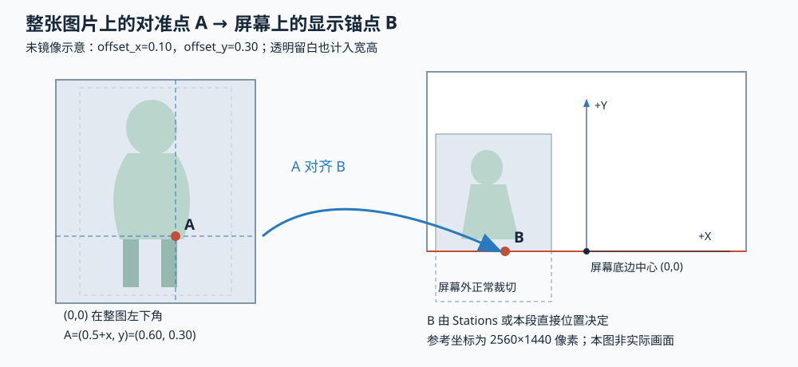

# 街景 NPC 内容与立绘配置

最后局部核对：2026-11-23，对照当前源码、正式CSV、生成角色引用、演出配置资产、已保存的Street与对话Prefab，以及正式导表和首次保存读回记录。本轮只维护说明；已保存引用不等于图片、转身、调参或整版体验已由用户检查通过。

当前普通对话已接入四张角色立绘、说话者高亮、名字换边、入退场、街景反应及开发期F8调参。正式入口是 `Assets/Scenes/LongLoop/LongLoop_Street.unity`；新增“人五”在默认状态发起三人→四人→自定义站位串联。第五锚点 `test_street_05_TUNE` 当前保存世界坐标 `(0.4,-4.75,0)`，只是待用户终调的起点。逐项内容见[本版占位校对清单](demo-0.1.5_占位校对清单.md)，实际体验见[人工检查说明](demo-0.1.5_人工检查说明.md)。

<a id="portrait-config"></a>
## 立绘：从图片到对话画面

### 1. 放图、导入、填角色表

1. 新图先按项目美术资源流程确认用途、最终路径与替换范围，再放 `Assets/Sprites/Narrative/Portraits/`；不要擅自覆盖已引用图。文件基名须在Sprite搜索目录中唯一且大小写一致，如 `portrait_vendor_default.png`。
2. 在Unity选择图片，Inspector的 **Texture Type=Sprite (2D and UI)**、**Sprite Mode=Single**，应用导入设置。这里使用整张PNG，包含透明留白；不要选Multiple或填旧切片名 `Potato_0`。Multiple会在导表时告警，该图不会接入，不能任选一片代替。
3. 打开唯一作者工作簿 `DevTools/DataTables/Authoring/DataTables_Authoring.xlsx` 的 **Characters** 页。`character_id`是已有基础角色ID；`portrait_sprite`只填精确文件基名，如 `Tomato`，不带目录、`.png`或切片后缀。`street_visual_prefab`是街景小人，与立绘不是同一列。生成的Sprite引用由导表器派生，不需要手填新引用列。
4. 配好下列角色取景三值，保存工作簿，经正式导出/校验发布CSV，再在Unity停止游戏时执行 **Tools > Data Tables > Import All**。查看本次报告和生成引用，重新进入游戏检查。不要直接改CSV、Generated资产或运行时克隆绕过作者源。

| 角色表列 | 单位、默认/空值 | 改动含义 |
| --- | --- | --- |
| portrait_offset_x | 整张图片宽度比例；空为0，有限，可为负 | 图片对准点X=`0.5+x`，从整图左边算。未镜像时增大让图片整体向左；右侧镜像时视觉方向相反。不是屏幕像素，也不是站位X |
| portrait_offset_y | 整张图片高度比例；空为0，有限，可为负 | 图片对准点Y=`y`，从整图底边算。增大让图片整体下移；0对齐底边，0.3对齐距底边30%处。允许下半部移到屏幕外正常裁切 |
| portrait_scale | 角色倍率；空为1，必须有限且>0 | 放大/缩小整张图片，仍绕同一对准点；最终倍率还乘站位倍率和本段cast倍率，说话时另乘高亮倍率。不是厘米、PPU或只裁人物可见轮廓 |



示意用x=0.10、y=0.30说明坐标，不是要求把现表改成此值。当前四角色x为空（按0），y均0.3；番茄/土豆/谈话人/主角的角色倍率分别1.43/1.36/1.58/1.44。**整张图片上的对准点对到屏幕显示锚点**；透明留白也参加宽高计算。两张石榴原画布不同，不能把同一偏移当成已经保证无跳变的表情差分。

### 2. 用 F8 找取景，再抄回作者源

在Editor或Development版本正常进入街景并开始有立绘的对话，按 **F8** 打开原面板，滚动到“立绘调参”。当前 `NarrativeSceneDebugPanel_TUNE` 上 **Narrative Scene Debug Panel > Portrait Stage** 已接同场景对话界面的舞台；发布版本没有F8。无舞台时整区隐藏；没有进行中对话/没有图时只显示说明。

每行是基础角色ID及其取景三值，按钮 **偏移X± / 偏移Y±** 每次0.01图片比例，**缩放±** 每次0.02，非正缩放拒绝。显示的是角色倍率，不是站位/段落/高亮相乘后的总倍率。同角色当前和后续批次共用临时覆盖，名单重复时多行会跟着同一角色变化。

找到合适值后点该行 **复制**，先粘到临时文本核对：一行依次为 `角色ID<Tab>x<Tab>y<Tab>缩放`，小数点为`.`，同一行也写Console。按ID找到工作簿Characters对应行，把后三值分别填回 **portrait_offset_x / portrait_offset_y / portrait_scale**；不要把ID粘到偏移列或把整行覆盖其它已有单元格。保存、正式导出/校验、停止游戏后Import All，再重新进入对话确认。

**清除全部临时值**恢复本舞台所有角色的原表取景，不清已聊记录；与“清空已聊过”按钮不同。F8不写工作簿、CSV或存档，关面板不会自动保存；同舞台Clear节点保留临时值，舞台实例销毁后消失。临时值可能继续盖住新表值，对比新导入结果前先清除或正常停止再进入。只在测试内容/测试存档操作其它F8功能。

### 3. 对话表出场列与三种站位写法

在 **Dialogues** 的 `cast_01`…`cast_04` 按出场顺序填基础角色ID；每槽的 `_station / _pos_x / _pos_y / _scale / _order` 只作用于本段。一个槽填一个ID，不是用逗号写多人。旁白角色通常不放入名单。

| 写法 | 示例 | 位置、倍率与次序 |
| --- | --- | --- |
| 自动排 | `cast_01=chr_test_tomato`，该槽station/pos都空 | 按**实际有图的人数**选1～4人站位组，再按有效名单顺序使用站位；无图者不占人数或位置 |
| 点名站位 | `cast_01_station=s3-left`，pos都空 | 精确区分大小写找名字；可选其它人数组的已命名站位，取该站的位置/倍率/层次。未知名字诊断后回该人的自动位置 |
| 直接给位置 | `cast_02_pos_x=-600`、`cast_02_pos_y=80` | 以屏幕底边中心为(0,0)的2560×1440参考像素；X右正、Y上正。**任意一项有值就覆盖整个station/自动位置**，另一项空按0；不继承该station倍率/层，站位因子回1、原层回0 |

优先级为 **直接位置 > 命名站位 > 自动排**。本段 `_scale` 空按1，与角色/站位倍率相乘，不覆盖角色表；`_order` 空继承所选站位layer（直接位置时为0），填了就覆盖本段基础层，数值大更靠前；同值按cast槽顺序，后者靠前。说话者还会在同批内临时置前，结束高亮后回基础排序。

当前可直接参考 `dlg_test_cast_custom`：土豆点名 `s3-left`；谈话人直接(-600,80)、本段scale=0.8、order=-1。这是现有测试段保存值，不是要覆盖其它段落的建议。

### 4. 全局站位表在哪里

Project选择 **Assets/Settings/Narrative/DialoguePresentationConfig.asset**，Inspector展开 **Data > Layout > 对应模板 > Stations**。默认模板name=`default`；`actorCount`是该组有图人数；entry的 **Id** 是station名字，**Position** 是显示锚点，**Scale** 是站位倍率（>0），**Layer** 是基础前后层。不要重名；跨组同名会诊断并选较小人数组，不用它做覆盖技巧。

| 人数 | 当前名字，按自动排顺序 | 保存位置(X,Y) | 保存倍率 / layer |
| --- | --- | --- | --- |
| 1 | s1-center | (0,0) | 1 / 0 |
| 2 | s2-left；s2-right | (-747,0)；(747,0) | 均1 / 0 |
| 3 | s3-left；s3-center；s3-right | (-853,0)；(0,0)；(853,0) | 均1；layer为0、1、0 |
| 4 | s4-left-outer；s4-left-inner；s4-right-inner；s4-right-outer | (-960,0)；(-400,0)；(400,0)；(960,0) | 0.9、1、1、0.9；layer为0、1、1、0 |

段落 `layout_profile` 选Layout整组模板，空用default；站位默认→指定组模板→有效段落overrides的规则见[参数说明](参数调整说明_对话.md)。`portraitBottomAlign` **本版不读**，不能靠开关它改变对准点。角色取景改Characters，整段排布改cast或Stations，两者不要混调。

### 5. 常见情况与提示

| 情况 | 当前表现 / 先查哪里 |
| --- | --- |
| 说话的人没在cast名单 | 不自动加图；现有图都按听众处理。姓名/正文仍照原句显示；名字框默认回左 |
| 旁白 | 没有当前高亮人物，已有图转听众态；旁白不借用上一句名字。名单无图时仍能正常显示文字 |
| 名单角色没有立绘 | 跳过该图，不计人数、不留空位；不会拿番茄占位或按街景形象猜图。核portrait_sprite、Single和生成引用 |
| 超过四人 | 当前表只有四个cast槽，未支持五人自动排。不要在一个槽塞列表；需五人时先提出扩展需求。非表入口若超过默认组会缺站位并回底中，不保证能读的排布 |
| 右边的人反向 | **NarrativeDialogueUI / Portraits / Narrative Portrait Stage > Mirror Right Portraits** 默认开；当前保存也开，只翻解析为Right的立绘。关后全正向；中/左不翻。不按临时横移或高亮后位置重新判断侧别 |
| 名字切到右边 | 当前说话者立绘的显示锚点在右侧时名字右对齐；其它情况左侧。右边位置来自左边镜像，正式调作者Name左侧即可 |
| Multiple、找不到、同名图告警 | 在本次Import All报告按表名/行/字段定位Characters.portrait_sprite；核图片Single、基名与唯一性，不能改已填业务值来掩盖真实问题 |
| 站位/倍率诊断或图不合适 | 查cast槽和Layout模板：未知station回自动、缺默认回底中(倍率1/层0)、非法倍率该因子回1。表格式合法不代表画面合适；重名/非法值应修作者配置，不把回落当正常排布 |

### 6. 街景主角、反应与已保存引用

`StreetDialogue_TUNE` 上的 **Narrative Street Reaction Adapter** 已保存本场景 **Dialogue Service / Target Registry / Street Camera / Player Controller** 四引用。Registry.Player保持 `PlayerRoot_TUNE/Foot_TUNE`；**Player Controller接该Foot所属 `PlayerRoot_TUNE` 上的 LongLoop Player Controller**，身份来自此控制器同节点Actor Marker。也兼容直接绑定控制器Transform；位置按Registry所绑目标取样，控制器仅沿自身/父链最近归属解析，不全场景搜索或借另一个主角的身份。不要把Registry改绑Visual来迁就控制器。

**位置保持；朝向在对话开始时转向对方一次，之后保持。** 同一轮续接不重复面对，结束不把主角朝向转回。听众按本段Reaction的FaceSpeaker/None和turnDelay响应；默认FaceSpeaker/0.2秒，随对白游戏时间一起暂停。None只取消听众转身，开始双方相向仍做；整次结束/中止恢复NPC首次原朝向。真实方向和节奏请按[五列人工表](demo-0.1.5_人工检查说明.md)检查。

## 一、让一个 NPC 能交谈

先完成四件事：创建角色与名称；创建普通对话及台词链；给街景 NPC 绑定这段对话；导出、导入并重新进入游戏。当前正式场景为 `Assets/Scenes/LongLoop/LongLoop_Street.unity`，通用壳为 `Assets/Prefabs/LongLoop/NPC/GenericNPC.prefab`。

### 1. 创建角色、对话与台词

| 工作簿页 / 字段 | 怎么填 | 例子与边界 |
| --- | --- | --- |
| Characters.character_id | 唯一基础角色 ID | 如 `chr_test_talker`。不要把名字、Hierarchy 对象名或实例后缀当作另一个基础角色行 |
| Characters.name_key | 本地化名字键；旁白角色可空 | `test_chr_talker.name` 当前对应“人四”。`chr_test_narrator` 的 name_key 为空 |
| Characters.street_visual_prefab | 街景视觉子 Prefab 的精确基名，可空 | `npc_visual_tomato`；不填路径、扩展名或通用壳名。正式目录 `Assets/Prefabs/LongLoop/NPC/Visuals/`，占位在其 `Placeholders/` |
| Dialogues.dialogue_id / tier | 唯一段 ID；可交谈段填 `normal` | 如 `dlg_test_talk_a`。`ambient` 给气泡用；本版交谈服务拒绝 `story`，金色标记也不会让剧情级可交谈 |
| Dialogues.first_line | 首句的 line_id | `ln_test_talk_a_01`。不能凭行的上下顺序决定开头 |
| Dialogues.next_dialogue | 同一轮结束后自动接的下一段，可空 | `dlg_test_talk_b` 接 `dlg_test_talk_b2`；尾段留空，不要指回自身或形成环 |
| Dialogues.cast_01…cast_04 | 本段出场的角色ID，可空；每槽另有站位/位置/缩放/次序 | 按本页立绘章填写；空名单仍能显示对白和姓名，有图角色才进入立绘人数 |
| Dialogues 的各 profile / overrides | 选演出模板或本段覆盖；不需要时留空 | `text_profile` 选文字模板；`overrides` 例见[参数说明](参数调整说明_对话.md)。不直接把这些字段当台词 |
| DialogueLines.line_id / dialogue_id | 句 ID 唯一；所属段要一致 | 一段每句都填准确的 dialogue_id |
| DialogueLines.next_line | 下一句 ID；最后一句留空 | 首句沿此链走，不能断链或成环 |
| DialogueLines.speaker | 普通正文的角色 ID | 填 Characters 中的基础 ID，如 `chr_test_passer_a`；发起交谈的街景实例可以是 `chr_test_passer_a#2`，二者不是同一用途 |
| DialogueLines.text_key | 正文的本地化键 | 如 `test_line_talk_a_01.text`，中文写在 Localization.zh_cn，不把正文直接塞进 text_key |
| DialogueLines.name_override_key | 只覆盖这一句的显示名，可空 | 如 `test_name_unknown.name` → “？？？”；不改变 speaker 的角色身份或 Characters.name_key |
| commands / on_end / expression / emotion / scene_emote 等 | 本版普通内容先留空 | 相关底层字段存在，但外部动作和表情表现尚未完整接入，不能靠填字符串制造尚未支持的效果 |

每个名字键、正文键和提示键都在 `Localization` 页填写唯一 `loc_key` 和中文 `zh_cn`。普通正文不要求 speaker 在街景上另有可见实例；其姓名来自角色数据。气泡的 speaker 则用于找场景挂点，规则见后文，不能混用。

### 2. 两条 NPC 配置路径

**直接预摆**适合只有这个实例需要的内容、额外测试 NPC，或已经在场景摆好的对象。把通用壳拖进街景，保稳定根、Foot、Visual Mount、Head 及三个子挂点；在根的 `Narrative Actor Marker > Character Id` 填完整且唯一的实例 ID。根的 `Narrative Dialogue Trigger` 设置 `Dialogue Id`、`Marker Value` 和可选 `Trigger Template`，接本场景 Runtime Entry、同一个 Dialogue Service 及同根 Actor Marker/Npc Shell。`Narrative Head Marker Driver` 引用本地 Marker View；场景依赖由同根触发器提供，通用 Prefab 不保存场景管理对象引用。

没有任何状态条目管理过的预摆，保自己的形象、位置、池和交谈绑定。例如当前土豆预摆根名为 `GenericNPC`，完整 ID 是 `chr_test_potato`，自身 Dialogue Id 保存为 `dlg_test_talk_c`；对象名不是 ID。已有通用 Head 局部 Y=2，别为错开提示而反复改旧 Head。

**状态生成或状态管理**适合按场景状态决定谁在场、站哪里、讲哪段。先在街景空对象上挂 `Narrative Anchor Marker` 并设置唯一 `Anchor Id`，位置对准 NPC 的稳定 Foot；再填 `Scenes`、`SceneStates` 和 `SceneStatePlacements`。本场景 `scene_asset=LongLoop_Street`，不含路径/扩展名；状态是完整配置，不是上一状态的差量。

| SceneStatePlacements 字段 | 填法 / 优先级 |
| --- | --- |
| scene_id / state_id / kind / target | 对应场景和已有状态；NPC填 `kind=actor`、完整实例 ID。`chr_vendor` 与 `chr_vendor#2` 不互相替代 |
| active | 要在场 true；退场也保行并填 false。inactive 条目仍会得到本状态的实际对话/标记绑定 |
| anchor_id | 无预摆、需生成时必须有有效锚点；有同 ID 预摆时留空可保自身位置 |
| dialogue_id | 非空覆盖该实例自身 Dialogue Id；留空回落实例自身。没有自身值才是不能交谈 |
| marker | 非空覆盖自身 Marker Value；空回落自身，再由实际对话推导。`none` 是明确隐藏，不是空值 |
| ambient_pool / facing | 池非空指定、空回落实例自身；朝向填 left/right，空保现有规则。不要用空值猜新业务内容 |

有同 ID 的预摆时用预摆；没有时应用器从通用 Prefab 生成并注入本场景依赖。形象由角色表非空 `street_visual_prefab` 指定；不指定时保实例自身，再无则不显示形象。明确指定但资源解析失败的兜底，与“源列空”不是一回事；不会把所有空列自动变成白块。

重新应用状态会先恢复曾受管预摆的自身值，再套目标状态。上次受管、本次省略的预摆回到自身值；从未被状态管理的额外预摆不动。因此不要把上一状态的覆盖当作实例默认值。修改自身 Dialogue Id 后若看不到变化，先看当前状态是否仍有非空 dialogue_id 覆盖；可用 F8 看“实际”值。

### 3. 标记怎么选

| Marker Value / marker | 显示与交谈关系 |
| --- | --- |
| 留空 | 回落实例自身；最终仍空时，实际 normal 段推导为「…」，story 段推导为金色「！」，没绑定段则无标记 |
| none | 明确不显示头顶标记，**仍可交谈**，是否能交谈看有效 normal 绑定和距离 |
| talk | 强制「…」；有有效绑定且该段已聊则用已聊颜色。没有效对话时也可能有符号，不能把“有符号”当准入证明 |
| story | 强制金色「！」，不因已聊变灰；只是样式，不开启本版未支持的剧情级交谈 |

任一对话开始时，全部接同服务的标记隐藏；结束按最新已聊状态淡回。标记、提示、气泡互不靠隐藏来避让，要调各自挂点。

## 二、旁白、逐句改名、接段与第二轮

- **旁白**：可参考 Characters 的 `chr_test_narrator`，名字键和立绘留空；普通句 speaker 填它，name_override_key 也留空，就不显示名字框。普通句 speaker 留空、名字覆盖也空，同样没有姓名。不要套用气泡“空 speaker 回挂池 NPC”的含义。
- **逐句改名**：speaker 仍填实际角色，只给这一句填 name_override_key，再在 Localization 配中文。下一句留空覆盖就恢复角色名字。直接写“？？？”到键列会被当作键查找，不能代替本地化行。
- **同一轮自动接段**：在前段 next_dialogue 填后段 ID。当前 `dlg_test_talk_b` 的两句结束后接 `dlg_test_talk_b2` 一句；后段有 `entrance.boxMode=ScalePop;text.charsPerSecond=12`，用于对比。当前按完整退出再入场，不把预留的无缝模式当现成效果。
- **聊完后的第二轮**：已聊只影响记录/灰态，不禁止再次交谈，也不会自动选另一段。再次开始同一绑定，会从同段 first_line 重新讲。要下一轮换内容，可在另一场景状态明确换 dialogue_id；当前土豆默认用自身 `dlg_test_talk_c`，`test_second` 条目覆盖为 `dlg_test_talk_a`。这是显式状态绑定，不是按已聊自动分支。next_dialogue 是同一轮续接，不能代替第二轮选择器。

## 三、填完怎样生效

1. 先保存并备份统一 xlsx 和要改的场景/Prefab；确认未保存改动归属。保留其它已填值、类型、公式和 ID，不拿旧 CSV 覆盖源表。
2. 用已有作者工具从本次工作簿忠实导出、做格式标准化和数据校验，先看逐格来源/差异，再发布已审派生 CSV 到正式 `DataTables/`。流程见[作者工具说明](../DevTools/DataTables/Authoring/README.md)。
3. Unity 停止游戏时用 `Tools > Data Tables > Import All`，看本次 errors/warnings/infos，核生成引用；不要手改 `Assets/Generated/` 代替导表。新美术先正常导入并解决缺失/同名。
4. 配场景自身字段或新锚点时，保存确认过的变化；运行实例上改值不等于已经保存到场景或 Prefab。重新进入游戏后再看当前实际绑定。目录/CSV更新不要靠反复初始化、热改或清存档代替导入。
5. 靠近 NPC，当前输入默认键盘 E。提示显示 E/A 是当前占位键帽，手柄确认键实际输入映射须按设备接线核对；不能把显示“A”当作已实现全部手柄按键适配。F8 开发面板可远距请求对话，但不能替代正常距离检查。

现有场景复用 `NarrativeRuntime_TUNE`、`NarrativeTargetRegistry_TUNE`、`NarrativeSceneStateApplier_TUNE`、`StreetDialogue_TUNE`、`NarrativeDialogueUI` 和 `InteractionPrompt`，不要另建第二套服务/选择器。Runtime读同一演出配置与生成Catalog；Service连同HUD Composition、Operation Lock；Selector连Registry/同Service/Prompt/输入。Player的锁和镜头游戏状态引用也指向现有同一组。通用壳的 Marker/Prompt/Bubble 本地件已保存；生成实例沿原注入通路工作。

## 四、已聊记录与安全重置

已聊按**对话段 ID**记录，正常结束写入；中途停用/中止不冒充完成。同段绑定给不同 NPC 会共享该段已聊状态，不是按 NPC 实例各记一份。不是一句一句或每次进场都自动清空。

代码使用 `Application.persistentDataPath/saves/long_loop.json`，节名为 `dialogue_talked`。本工程保存的 Company Name 是 `Trollemma`、Product Name 是 `EatWhat`，据此推得 Windows Editor/Player 的通常路径：

```text
%USERPROFILE%\AppData\LocalLow\Trollemma\EatWhat\saves\long_loop.json
```

这是根据项目设置和 [Unity persistentDataPath 官方说明](https://docs.unity.com/en-us/engine/6000.3/script-reference/unityengine/application/persistentdatapath)推导的默认位置，本次没有访问玩家目录或核读用户文件；改公司/产品设置、系统重定向或其它平台时以实际运行返回的 persistentDataPath 为准。文件不在工程 `Assets` 下，也不是安装目录的配置表。

**开发时推荐只清这一节**：在 Editor/Development Build 的游戏中按 F8，点击实际按钮 **“清空已聊过”**。它调用当前服务的记录清空并立即保存，保留该文件其它已存在的有效节；不会清短循环存档或改配表。缺服务/记录未准备好时按钮不显示。成功看面板提示；“内存已清，保存失败”不代表磁盘已重置。进行中的段正常结束仍可能重新记为已聊，最好先结束测试对话再清。

F8 的 `Apply <状态>` 会重新应用状态；已有状态之后，即使 Apply 当前状态，也会清**目标状态最终绑定的对话**并保存，包含inactive行；首次成功应用不清。它同时会改场景状态，不能把 Apply 当作只清记录的按钮。对话进行中 Apply 不可用。

**发布包没有 F8，也没有独立的“只清已聊节”菜单。** 当前发布代码加密并校验存档，Editor/Development虽用明文也带校验；两者都不要手工改正文或节内容。Editor/Development与发布编码不同，同公司/产品设置下又可能使用同一路径，按各自构建分别备份，不假定明文档与加密档可直接互换。

如只想重置当前版本整份已聊测试进度：完全退出游戏，并停止使用同一路径的Editor游戏；手动备份这个**单独的** `long_loop.json`，再把该文件移到备份目录，保留其它文件不动。当前版本 `long_loop` 只由已聊记录写入，因此下一次载入会从空已聊开始；不要清空 `saves` 文件夹、用户根目录、短循环 `default` 槽或安全密钥。要回退时，先退出并保留新文件，再把原备份原字节放回同一路径。

移走文件是重置整个长循环槽位，不能当作未来版本“只删某个节”的通用方法。若此文件以后存了其它长循环进度，或仅想清指定几段，需开发方经原存储接口处理，不能编辑加密文件、伪造校验或整删有其它进度的文件。本说明没有执行任何清档操作。

## 五、三个挂点、气泡与旧内容

在 NPC 稳定 Head 下分别调 Shell 的 `Marker Anchor`、`Prompt Anchor`、`Bubble Anchor` 引用。通用 Prefab 于 2026-11-21 核对的相对 Head 保存位置为标记 (0,4.6,0)、提示 (0.6,4.6,0)、气泡 (0,5.25,0)；为空各自回落旧 Head。Head 自身局部 Y=0。实例覆盖与父级缩放会影响最终世界位置。标记中心对点，提示默认左中点对点并向右展开，气泡底边中点对点并向上展开；标记圆片约0.85世界单位，提示/气泡是按2560×1440参考画幅缩放的屏幕UI。

环境气泡继续用 `tier=ambient` 段、完整 DialogueLines 链和 `AmbientPools.dialogue_ids`，多段ID用英文分号分隔。池多段用于选段，多句链在后续触发逐句推进，不是一次弹全部。气泡句 speaker 空时取挂池 NPC；非空按场景完整实例 ID 找 Bubble Anchor（如 `chr_test_passer_a#2`），不同于普通正文查基础角色姓名。距离用 `autoBubbleRadius`，不是交谈的 interactRadius；已有冷却不因换池或调值立即退款。对话进行时仅发起者暂停新冒泡，已显示的泡与其它 NPC 不因此消失。

当前两状态各有六个完整 target，共十二行；土豆默认沿预摆自身 `dlg_test_talk_c`/`amb_test_a`，第二状态换绑定并到03锚点；新谈话角色两个状态都在04锚点。当前占位行与核对点见[校对清单](demo-0.1.4_占位校对清单.md)。

## 六、常见提示先查哪里

| 提示或现象 | 先查哪里 |
| --- | --- |
| `DIALOGUE_MISSING` 或缺段诊断 | 实际绑定的段ID、Dialogues行、first_line/链、是否导入到当前Catalog；先看F8实际段，不只看Inspector自身值 |
| `DIALOGUE_START_REJECTED` / `DIALOGUE_BUSY` | 是否已有一段进行；是否误建两个服务，按钮是否被重复接线 |
| `AMBIENT_NOT_APPLICABLE` / `AMBIENT_NOT_INTERACTABLE` | 是否把ambient气泡段当normal交谈绑定 |
| `STORY_NOT_SUPPORTED` | 当前服务只接normal；改标记样式不能解锁story |
| `SERVICE_UNAVAILABLE` / `COMPOSITION_BINDINGS_MISMATCH` | 场景服务Runtime/锁、同HUD Box/Dimmer/Composition引用是否完整一致 |
| `TRIGGER_UNAVAILABLE` / `MARKER_TRIGGER_UNAVAILABLE` | Trigger Template拼写、default唯一性、演出配置是否有效 |
| `INVALID_MARKER` | marker只允许空、none、talk、story；检查源表及实例优先级 |
| `#某键#` 或名字/正文空 | Localization键和中文、speaker基础角色行、name_override_key；旁白空名是正常情况 |
| `TALKED_LOAD_FAILED` / `TALKED_SECTION_INVALID` / `TALKED_WRITE_FAILED` | 存档读写/校验问题；原件会保留或阻写，不靠反复清文件/改签名消掉提示 |
| 表校验 `[V-25]` / `[V-26]` | 前者看已保存场景接线/锚点/空值；后者看同状态自挂池和别的池speaker竞争，含实例自身池一起看。Warning不是自动改业务值的许可 |
| 有标记却没提示 / 没标记却能交谈 | 标记样式与交谈准入独立；再核有效normal段、Foot距离、锁、唯一Selector、Prompt相机/字体/本地化键 |

字段完整定义与资源绑定规则仍可查[剧情配表说明](剧情八表配表说明.md)、[NPC组件说明](../组件说明文档/视觉特效/街景NPC_Prefab配置与使用说明.md)及[气泡组件说明](../组件说明文档/视觉特效/剧情气泡配置与使用说明.md)。本次核对没有写表、导入素材或改变任何玩家记录。

## 附录：从零配置 NPC 的完整操作参考

以下保留既有的资源、场景、气泡与直接预摆操作；普通交谈新增章节在本文前部，字段优先级共同适用。

## 路径一：用配表往街上增加 NPC

### 1. 准备角色与形象

打开统一源工作簿 `DevTools/DataTables/Authoring/DataTables_Authoring.xlsx`，在 `Characters` 页新增角色行。新角色使用唯一的 `chr_` ID，例如 `chr_vendor`；名称在 `name_key` 填本地化键，再在 `Localization` 页填对应中文。不要把显示名当作 ID，也不要从旧 CSV 重建覆盖人工工作簿。

街景形象是**可视子 Prefab**，存放在 `Assets/Prefabs/LongLoop/NPC/Visuals/`，开发占位在其 `Placeholders/` 子目录。已有可用例子是 `npc_visual_tomato.prefab`。`Characters.street_visual_prefab` 只填 `npc_visual_tomato` 这样的精确文件基名，不填路径、`.prefab` 或额外空白；大小写必须一致，正式与占位目录中也不能出现同名候选。

形象挂到通用壳的 `Visual_TUNE` 下；不要把带完整 Shell、Foot、Depth Scale、Sorting Group 的逻辑壳再次作为形象。新美术的组织与接入见[缺失内容清单](街景NPC缺失内容清单.md)。导表会派生真正的 GameObject 引用 `street_visual_prefab_asset`，它不是需要手填的新列。立绘不是街景形象，本版冒泡不要求给测试角色补立绘。

`chr_vendor#2` 表示同一基础角色的第二个场景实例：形象查 `Characters.character_id=chr_vendor`，场景找人时则按完整 `chr_vendor#2` 比较。无需为后缀再建一个基础角色行。`chr_vendor`、`chr_vendor#2` 和 `chr_vendor#3` 互不替代；对象在 Hierarchy 中的名称也不替代 Character Id。

### 2. 放锚点，填写场景与完整状态

在 `Assets/Scenes/LongLoop/LongLoop_Street.unity` 中新建独立空对象，添加 `Narrative Anchor Marker`，设置唯一的 `Anchor Id`，再把对象移到希望 NPC 脚底站的位置。锚点 Transform 使用 Unity 世界单位，不能放进会被替换的形象子树。现有 `test_street_01_TUNE` 等对象可作为观察例子；用户已调整过它们，以当前已保存场景位置为准。

工作簿中依次填写：

1. `Scenes`：唯一 `scene_id`、本地化 `name_key`、`scene_type`、`is_small_room`、`scene_asset` 和 `default_state`。本场景文件基名必须是 `LongLoop_Street`，不是简称 Street；不含路径或扩展名。
2. `SceneStates`：给同一场景列出每个状态，组合键为 `scene_id + state_id`。`default_state` 必须指向本场景已有状态。
3. `SceneStatePlacements`：每个状态填写完整条目，组合键为 `scene_id + state_id + kind + target`。NPC 的 `kind=actor`，`target` 填完整角色 ID，`active` 必填 true/false；要移动时填准确 `anchor_id`，要改朝向才填 `left/right`。当前本版不处理物件、出口或一次性触发区。

每个状态都要列全要管理的角色，不能把第二个状态写成对第一个状态的差量。角色退场也保留行并填 `active=false`。有同 ID 预摆时可空锚点以保原位；没有预摆则应填锚点，通用壳才有明确出生位置。角色移动以壳的稳定 Foot 对齐锚点，不是把贴图中心对到锚点。

本次演示工作簿中，`test_default` 与 `test_second` 现在各有番茄、基础路人、路人#2、人三、土豆六个完整 target（新增人四），共十二行。用户保存的土豆预摆有自身番茄形象与 `amb_test_a`：默认状态的土豆条目 anchor/pool 留空，保自身位置和单句池；第二状态将土豆放到 `test_street_03` 并指定 `amb_test_a`。第二状态基础路人仍保行但 `active=false`。十二条状态行均已导入；当前内容以本文占位校对和正式CSV为准。

### 3. 配 ambient 段、句子和池

在 `Dialogues` 新增唯一 `dlg_` ID，`tier=ambient`，`first_line` 指向首句。ambient 不使用立绘出场名单，不需要填写 cast；本版气泡也不执行句子命令。不要借此配置普通交谈或剧情演出。

在 `DialogueLines` 按顺序填写唯一 `ln_` ID、所属 `dialogue_id`、`next_line` 和 `text_key`；末句的 `next_line` 留空。在 `Localization` 为每个 `text_key` 填中文。首句要可达，链不能断或成环，所属段标签必须一致。

`speaker` 留空表示从挂池 NPC 的头顶发出；填角色时按**完整实例 ID**找对应角色的 Bubble Anchor（空回落Head）。例如段挂在 `chr_vendor#2` 身上，但句子的 speaker 写 `chr_vendor`，会找基础实例而不是自动改成 `#2`。指定角色或头顶挂点不存在会诊断并跳过该句。

在 `AmbientPools` 新增 `amb_` ID，`dialogue_ids` 用英文分号连接已存在的 ambient 段；只有一个段也照填 ID。`scope/comment` 是说明，不负责选择角色。最后在每个状态的角色条目 `ambient_pool` 填池 ID。多段池用于选段，多句链用于后续触发逐句推进，不是一次调用连播全部句子。

当前占位改法见[校对清单](demo-0.1.3_占位校对清单.md)：默认状态番茄及基础路人的 `ambient_pool` 清空，它们只作为双人段的两个 speaker；`chr_test_passer_a#2` 独自持有 `amb_test_c` 作为双人段发起者，土豆保自身 `amb_test_a` 单句池。第二状态 #2 已停用，番茄指定 `amb_test_b` 三句单人链，土豆使用 `amb_test_a`。空池不是全局禁用：预摆会回落自身池，故核“是否竞争”时须同时看场景实例 Pool Id 和状态条目。

### 4. 核对场景接入，再让数据生效

Street 当前已保存以下接入，新增 NPC 应复用本场景对象，不再建一套重复管理器：

| 场景对象 | 要核对的 Inspector 引用 |
| --- | --- |
| `NarrativeRuntime_TUNE` / Narrative Runtime Entry | Presentation Config 指向 `Assets/Settings/Narrative/DialoguePresentationConfig.asset`；Data Catalog 指向现 `CK01GeneratedDataCatalog.asset` |
| 同对象 / Narrative Bubble View | Surface Provider 指向同对象的 Narrative Bubble Canvas Renderer |
| 同对象 / Narrative Bubble Canvas Renderer | World Camera=`Cam_Street`；Font Asset=`Assets/Fonts/Heavy/ShortCycle_Heavy_WithFallback.asset`，均为显式引用 |
| `NarrativeTargetRegistry_TUNE` | Player 指向 `PlayerRoot_TUNE/Foot_TUNE`，用于地面距离与内建 `player` 目标 |
| `NarrativeSceneStateApplier_TUNE` | Runtime Entry、Target Registry、Bubble View 接上述对象；Generic Npc Prefab 接 `GenericNPC.prefab`；Placeholder Visual Prefab 接现白块占位；Generated Npc Parent 接自身 Transform；Apply Default On Start 当前 true |

完成源表后，按下面顺序生效：

1. **保存并备份统一 xlsx。** 先停止游戏测试，不让配表、导表与场景写入同时进行。保留表头、类型、公式与其它已填内容；只修改明确要变更的配置。
2. **用原作者工具忠实导出并校验。** 下例在工程根运行，只导出到新的工程外目录，便于先看差异：

   ```powershell
   pwsh -NoProfile -File DevTools/DataTables/Authoring/Export-AuthoringToCsv.ps1 `
     -InputWorkbook DevTools/DataTables/Authoring/DataTables_Authoring.xlsx `
     -OutputRoot C:/Temp/EatWhat-NpcContent `
     -ReportDirectory C:/Temp/EatWhat-NpcContent-Reports
   ```

   工具同时生成整体格式候选、逐格来源 `cell-provenance.json` 和校验结果。确认工作簿值/类型/公式未被格式操作改变、CSV 忠实来自本次源表，再按[作者工具的正式发布流程](../DevTools/DataTables/Authoring/README.md)发布已审且确有变化的派生 CSV 到正式 `DataTables/`。每次都连同角色、本地化、段/句和placement的本次实际差异核对后成组发布；无差异的 Cooking 等表不重写。隔离导出本身不会让游戏更新；不要拿旧 CSV 反向覆盖源工作簿，也不要绕过原发布流程直接覆盖文件。
3. **在 Unity 停止状态导表。** 源 CSV 正式发布后，使用真实菜单 `Tools > Data Tables > Import All`，查看该次报告。它更新生成行、Catalog、本地化与形象引用；新增形象须先经审定目录正常导入。不要手工改 Generated 资产代替导表。
4. **保存场景后做离线审计。** 在工程根运行 `pwsh -NoProfile -File DevTools/DataTables/Validate-DataTables.ps1 -Quick`，阅读返回 JSON 的 `errors/warnings/infos`，特别是 `[V-25]`。工具只读磁盘，未保存的移动/引用不会被它看到；接线前的旧报告也不会随场景保存而自动更新。
5. **重新进入游戏检查。** 当前默认状态来自 `Scenes.default_state`。内容或目录修改后应停止再进入，不能靠反复 Initialize、热改 CSV 或清冷却来模拟刷新。按[占位校对清单](demo-0.1.3_占位校对清单.md)看站位、在场状态、形象、句子和头顶附着；引用可读和零 Error 不等于体验已通过。

发布工具需要的备份、源版本和审计参数以原作者工具说明为准。文档里的示例路径不是一键发布授权，也不是已经替用户执行。

## 路径二：先直接预摆，不新增状态条目

可以先复用已导入的气泡池，在场景中直接预摆一个 NPC 看外形和冒泡。它仍使用现有场景 Runtime/Registry/View，不是运行时另读一套数据。

1. 在停止状态打开 Street，把 `Assets/Prefabs/LongLoop/NPC/GenericNPC.prefab` 拖进场景。根选一个不会与现有角色重复的合法 Character Id；不要只改对象名称。壳已有Npc Shell、Narrative Actor Marker、Narrative Ambient Bubble Trigger，以及普通Dialogue Trigger、Marker Driver和子View；此处Trigger若提Pool Id，特指Ambient Bubble Trigger。
2. 保持 Npc Shell 的 Foot=`Foot_TUNE`、Visual Mount=`Visual_TUNE`、Head Anchor=`HeadAnchor_TUNE`。把选定形象子 Prefab 放到 `Visual_TUNE` 下，通常从子对象局部零点、单位旋转/缩放开始，再按素材实际枢轴确认；这是建议起点，不是对所有美术的保证。不要另套一层通用壳。
3. 调整 NPC 根的位置以摆脚底，按实际形象调整稳定 `HeadAnchor_TUNE` 的局部高度。Foot/Head 都应留在可替换形象外；不要移动 Visual 当作脚底距离点。番茄形象的 MeshRenderer 由现 Bootstrap 在运行时启用，Edit 中暂不可见不等于应永久打开它或删除 Bootstrap。
4. 在该实例的 Trigger 上接本场景 Runtime Entry、Target Registry、Bubble View，以及同根 Actor Marker、Npc Shell。`Pool Id` 可先用已导的 `amb_test_a`，或自己的已导 ambient 池；留空则不冒泡。`Trigger Template` 留空沿原 default；它不是池 ID。不要把场景引用 Apply 回通用 Prefab 资产。
5. 保存场景。若该完整 ID 没有状态条目，状态应用不会替它指定形象/池；自身子形象和 Pool Id 保留。离线审计可能报告“预摆无状态条目”，应记录这是暂时预摆，后续纳入每个完整状态，而不是编造条目消警。已保存的土豆现有完整状态条目，不属于这个“无条目”例子。进入游戏看显示效果；气泡仍要求配置、本地化、玩家脚底、Head 和 View 都有效。

仅用已有气泡池试摆时，这条路径省去的是新增状态条目或另建气泡内容，不是省去已有 Runtime、池、句子和本地化。想换成自己的台词，仍走上面的源 xlsx→导出校验→正式导表流程。

## 配表与实例自身的取值顺序

| 配置情况 | 实际处理 |
| --- | --- |
| 状态里有该角色条目且 active=false | 停用；位置/朝向/形象/池按原不在场流程跳过，但当前dialogue/marker仍写实际绑定并属于目标状态清已聊范围 |
| actor 填 anchor_id | 按精确锚点移动 Foot；空锚点预摆保原位，新生无锚点停用并诊断 |
| facing 填 left/right / 留空 | 指定朝向 / 保自身，不套另一个方向默认 |
| 基础角色行填了形象名且导入引用有效 | 形象优先于实例自身；替换的是 Visual Mount 下的可视子对象 |
| 角色行无形象名，或没有角色行 | 保实例自身形象；自身也没有就无形象，**不会自动变白块** |
| 明确填了形象名但引用缺失 | 诊断；有配置 Placeholder Visual Prefab 时用该占位，不把空列误当缺失 |
| 条目填 ambient_pool / 留空 | 写指定池 / 保实例自身池；自身也空则不冒泡 |
| 状态没有这个预摆完整 ID 的条目 | 不按另一个 ID 或上个状态的条目补齐；预摆保自身配置，同时有审计提示 |

重应用先清应用器自己生成的 NPC，并恢复预摆首次应用前的必要配置，再应用新完整状态；空值不用于继承上一个状态临时指定的形象/池。改变池会清该池的句进度，但不会缩短已有正常冷却。详细恢复边界见[场景状态说明](街景场景状态配置与使用说明.md)。

## 常见告警与排查

| 现象或诊断 | 先看哪里、怎么处理 |
| --- | --- |
| Runtime、Catalog、Player、View、Camera 或 font 缺引用 | 按场景引用表核对实际对象、同场景与启用状态；不靠调半径或字体自动回落掩盖缺接线 |
| 显示 key、缺正文或缺字 | 核 `text_key`、Localization 页与最新本地化导入；再核 Renderer 的显式字体及合法 fallback 字形。旧文案的字形覆盖证据不保证新增中文，也不代实际可读检查；不要擅改受保护字体/材质 |
| `[V-25][MISSING_ANCHOR]` | 核该状态条目的 anchor_id 与场景 Marker 的 Anchor Id、拼写/大小写及是否保存 |
| `[V-25][NO_PREPLACED]` | 空锚点但无同完整 ID 预摆；要么按真实设计预摆，要么填真实锚点，不能用基础 ID 冒充带后缀实例 |
| `[V-25][UNLISTED_ACTOR]` / 状态不完整 | 核同 scene_id/state_id 的四字段组合键及完整条目；其它状态或场景的行不替代。场景内建player目标、主角Actor Marker与NPC条目用途不同；当前已有正式chr_test_player供普通正文姓名，不为消警另补虚假条目 |
| `[V-25][UNVERIFIED]` | 场景/Prefab 缺失、空坏，或新增组件/嵌套/variant 等文本表示超工具支持；记为未核，交具体资源/接线检查。它不是干净通过，不要求为了零警告重写合法资源 |
| 形象不见 | 区分空列与“填名但未绑定”；核精确文件名、重复候选、生成引用、Visual 子对象和 active。空配置没有自身形象时不自动补白块 |
| 池/句子不播 | 核池 ID、ambient 等级、首句/链、本地化、speaker 完整 ID 与其Bubble Anchor/Head；自然触发还受实际地面距离和既有冷却限制。空池关闭，缺 speaker 会跳句，不能重建模型洗冷却 |
| 模板/默认命令上下文未核信息 | 先确认报告生成时是否提供配置上下文，结合真实配置核对；不把独立未核信息改写成模板必定缺失 |


当前已保存普通交谈HUD、锁、服务、选择器与已聊记录接线；旧气泡步骤只解释ambient路径，不否定本文开头普通对话章节。站位/内容和运行体验仍分开校对，不以清空Warning代替签收。
